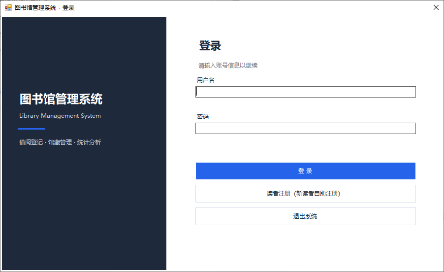
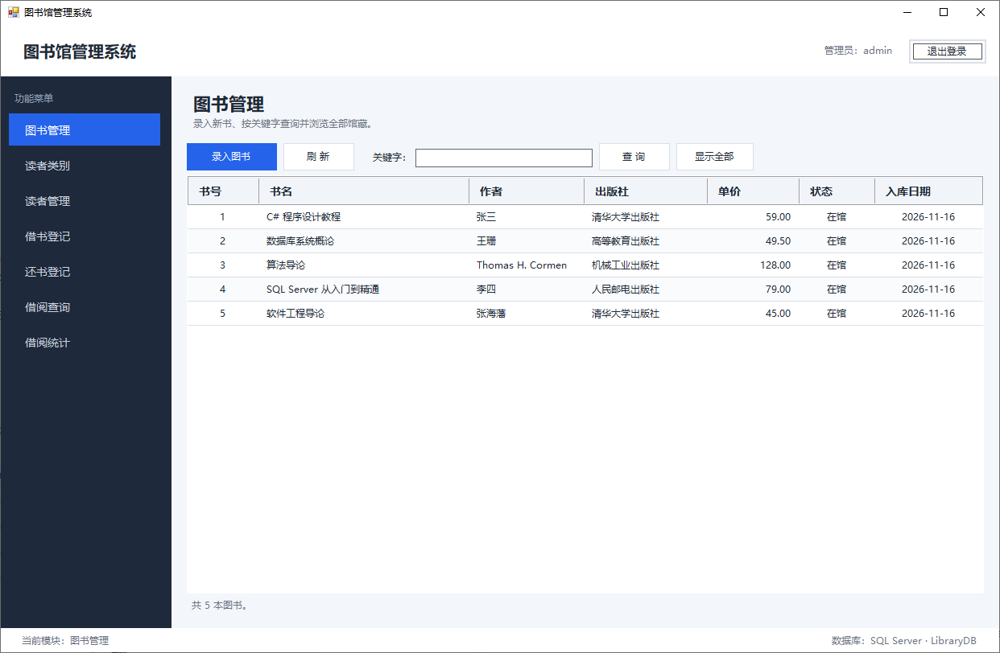
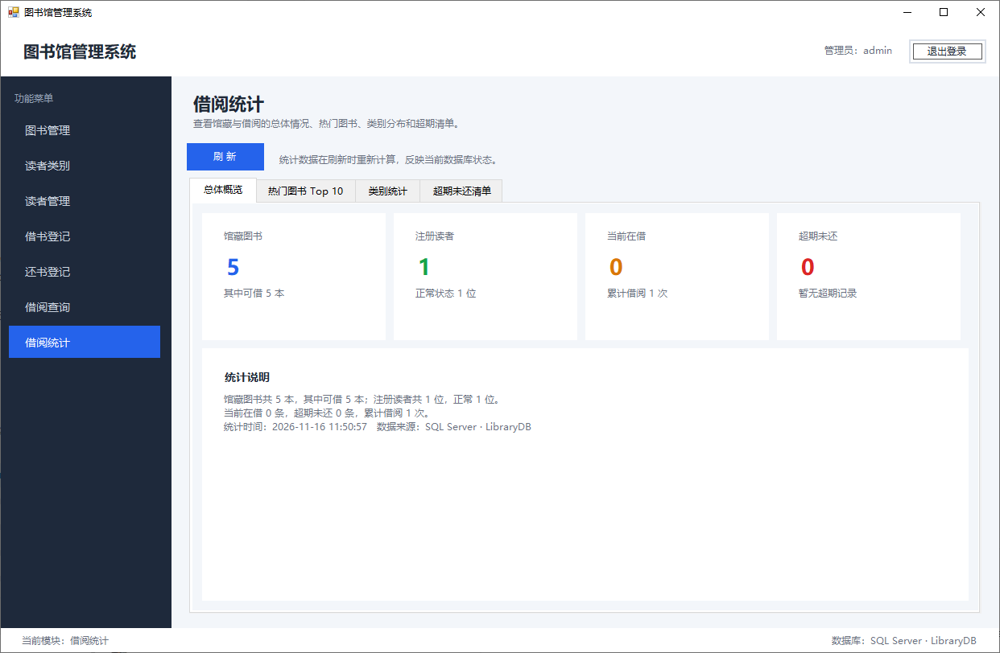

# 学校图书馆管理系统（C# / WinForms / SQL Server）

课程设计项目：图书、读者、读者类别与借阅记录的规范化管理，含管理员与读者两类角色，桌面图形界面。

## 技术栈

| 项目 | 选型 |
|------|------|
| 语言 / 框架 | C#（源码兼容 **C# 6**）/ **.NET Framework 4.8** / **Windows Forms** 桌面应用 |
| 编译器 | 优先 `dotnet build`（装有 .NET SDK 的机器）；无 SDK 时回退 VS2015 自带 `csc.exe`（C# 6） |
| 数据访问 | 原生 ADO.NET（`System.Data.SqlClient`），全部参数化查询 |
| 数据库 | SQL Server 2008 R2+（已在 2008 R2 Express 与 2012 上验证） |
| 架构 | 三层：UI → BLL → DAL（依赖单向向下） |

> `LibraryMS.csproj` 声明 `LangVersion 7.3`，但代码刻意不使用 7.x 语法（已用 `-p:LangVersion=6` 实测通过），因此同一份源码既能被 705 教室的 VS2015 Roslyn（C# 6）编译，也能被 710 教室的 .NET SDK 编译。

## 界面预览

| 登录 | 图书管理 |
|---|---|
|  |  |



## 目录结构

```
Class-Design/
├── run.bat                     # 一键启动（自动校验产物 + 构建 + 运行）
├── database/
│   ├── 01_create_database.sql  # 建库建表 + 种子数据（非破坏性，可重复执行）
│   └── 99_reset_database.sql   # 清空重建（危险操作）
├── docs/                       # 需求规格、工作流、安全清单等设计文档
└── src/LibraryMS/
    ├── LibraryMS.csproj
    ├── App.config              # 数据库连接字符串
    ├── Program.cs              # 入口：登录 → 主窗体 → 退出登录 的会话循环
    ├── Models/                 # 实体模型
    ├── DAL/                    # DbHelper + 6 个 DAO
    ├── BLL/                    # 认证、图书、读者、借还、统计
    └── UI/
        ├── Common/             # 主题配色、表格列定义、对话框基类、忙等遮罩
        ├── Forms/              # 登录、首次建管理员、主窗体、各类录入对话框
        └── Views/              # 主窗体右侧的 10 个功能页（管理员 7 + 读者 3）
```

## 快速开始

> 完整的环境要求、启动自检清单与故障排查见 [docs/06-quick-start.md](docs/06-quick-start.md)。

### 1. 初始化数据库

在项目根目录执行（`-E` 表示用当前 Windows 账号连接，无需密码）：

```powershell
sqlcmd -S localhost -E -f 65001 -i database\01_create_database.sql
```

若你的实例允许 `sa` 登录，也可用 `-U sa -P 你的密码` 替代 `-E`；命名实例（705 教室）把 `-S localhost` 换成 `-S localhost\SQLEXPRESS`。也可以用 SSMS 打开 `database\01_create_database.sql` 直接执行。

> 脚本为 UTF-8 无 BOM，SQL Server 2008 R2 自带的 sqlcmd 10.0 必须加 `-f 65001`，否则中文注释会被按本地代码页解析，导致建表语句被吞掉。

### 2. 启动程序

**双击 `run.bat`**（推荐），或运行：

```
src\LibraryMS\bin\Debug\net48\LibraryMS.exe
```

`run.bat` 的构建逻辑：先校验 `bin\Debug\net48\LibraryMS.exe` 的体积（正常约 150 KB）——若异常小、或比 `obj\Debug\net48` 里刚编译出的文件大一倍以上（典型症状是被文件感染型病毒改写），就删除后重建；构建时先试 `dotnet build`，失败或本机没有 .NET SDK 时自动回退到 VS2015 的 `C:\Program Files (x86)\MSBuild\14.0\Bin\csc.exe`（C# 6）编译，并确保 `App.config` 复制为 `LibraryMS.exe.config`。

> ⚠️ 不要运行 `obj\Debug\net48\LibraryMS.exe`：那是编译中间产物，**没有配套配置文件**，会提示"未找到名为 LibraryDB 的连接字符串"。

### 3. 首次使用

首次启动会要求创建管理员账号（用户名 3-20 位字母/数字/下划线，密码 6-32 位）。创建后即可登录。读者可在登录页点「读者注册」自助注册，或由管理员在「读者管理」里为已有读者开通账号。

## 已验证的运行环境

| 项目 | 版本 / 说明 |
|------|------------|
| 操作系统 | Windows 10 专业版 1909（10.0.18363，64 位） |
| 运行时 | .NET Framework 4.8（4.8.03752） |
| 编译工具 | 705 教室：MSBuild 14.0 / VS2015 `csc.exe`（无 .NET SDK）；开发机：.NET SDK 8.0.400 的 `dotnet build` |
| 数据库 | SQL Server 2008 R2 Express 10.50（`localhost\SQLEXPRESS`）；SQL Server 2012 SP1 11.0.2100（`localhost`，仅 Windows 身份验证） |
| 业务验证 | BC-01..BC-10、RC-01..RC-06 边界用例逐条执行通过，记录见 `docs/02-workflow-borrow.md` |
| 界面验证 | 管理员 7 个模块与读者 3 个模块逐个打开无异常；登录、主窗体导航、统计页数值与数据库一致 |

## 功能清单

### 管理员（7 个模块）

1. **图书管理**：录入（名称/作者/出版社/单价）、按关键字查询、全部列表
2. **读者类别管理**：查看、新增、修改（可借数量 1-50、可借天数 1-365）
3. **读者管理**：录入（自动生成编号）、查询、全部列表、注销、为读者开通登录账号
4. **借书登记**：校验读者状态/可借上限/超期，原子更新图书在馆状态
5. **还书登记**：按借阅号归还或按读者查询在借清单，幂等处理重复还书
6. **借阅记录查询**：按读者编号、关键字、状态（在借/超期/已还）组合筛选
7. **借阅统计**：总体概览卡片、热门图书 Top 10、类别统计、超期清单

### 读者（3 个模块）

1. **查询图书**：按书名/作者/出版社关键字检索
2. **我的借阅**：查看本人全部借阅历史与状态、可借额度与超期情况
3. **修改密码**

## 设计要点（对应课程要求）

| 要求 | 实现 |
|------|------|
| 参数化查询防注入 | 所有 SQL 经 `SqlParameter` 传递；LIKE 通配符额外转义（`BookDao.EscapeLike`） |
| 事务一致性 | 借书、还书、读者注册、读者注销、编号生成均在 `SqlTransaction` 中完成，异常自动回滚 |
| 读者编号规则 | `R` + 类别号 2 位 + 年份 4 位 + 序号 3 位，如 `R022026001`；事务内 `UPDLOCK, HOLDLOCK` 防并发重号 |
| 读者编号唯一 | 主键约束 |
| 用户名唯一 | `UQ_Users_Username` 唯一约束 + 友好错误提示 |
| 关联号必须存在 | 4 个外键（读者→类别、借阅→读者、借阅→图书、用户→读者）+ 数据库层兜底 |
| 密码安全 | PBKDF2-SHA256 / 10 万次迭代 / 每用户 16 字节盐 / 常量时间比较 |
| 并发安全 | 借书条件更新 `WHERE IsAvailable=1`；借阅表唯一过滤索引 `UQ_Borrows_ActiveBook` |
| 超期规则 | 超期未还禁止再借（已确认）；超期不罚款，仅提示天数 |
| 界面一致性 | 统一色板与控件工厂（`AppTheme`）、统一表格列定义（`GridColumns`）、耗时操作有忙等遮罩 |

## 常用验证 SQL

```sql
USE LibraryDB;
SELECT * FROM dbo.Books;
SELECT * FROM dbo.Readers;
SELECT * FROM dbo.V_BorrowDetails ORDER BY BorrowId DESC;
SELECT * FROM dbo.Users;
```

## 常见问题

| 现象 | 原因与处理 |
|------|-----------|
| 双击 exe 弹出 `Execution Processing Message (0xc0000005) - Unexpected parameters`，或 "This application could not be started." | 文件已不是有效的托管程序集——**被文件感染型病毒改写了**。正常产物约 150 KB（154112 字节）；若变成 700 KB～1 MB 级即可确认（这类病毒会把 exe 包成 Delphi 外壳）。删除该 exe、用 `run.bat` 重编译，并对本机全盘杀毒。开发机上实测的感染源是 `C:\ProgramData\Synaptics\Synaptics.exe`（无签名，挂在 `HKLM\SOFTWARE\WOW6432Node\...\Run` 下伪装成触摸板驱动）；清理后重新编译，产物即恢复为 154 KB 并可正常启动 |
| 未找到名为 LibraryDB 的连接字符串 | 运行了 `obj` 目录的 exe；请改用 `run.bat` 或 `bin\Debug\net48\LibraryMS.exe` |
| 无法连接数据库 / 提示用户 'sa' 登录失败 | SQL Server 默认只允许 Windows 身份验证。改用 `Integrated Security=True`（默认配置），或在 SSMS 里开启混合模式并启用 sa 后同步修改 `App.config` |
| 编译报 `MSB3027 / MSB3021`（文件被占用） | 程序仍在运行占用了输出文件，关闭程序窗口后重试 |
| NuGet 还原失败 | 本项目不依赖任何 NuGet 包（net48 内置 SqlClient），无需联网还原 |
| `run.bat` 提示 Neither .NET SDK nor MSBuild 14 csc.exe was found | 本机既无 `dotnet` 也无 VS2015：装 .NET Framework 4.8 Developer Pack，或把编译好的 `bin\Debug\net48\` 整个目录拷过来直接运行 |
| 双击 `run.bat` 一闪而过、程序没起来 | 先看脚本打印的 `[WARN]/[ERROR]`；也确认 `bin\Debug\net48\LibraryMS.exe.config` 存在（脚本仅在缺失时复制 App.config） |
| 改了 `App.config` 但连接没变 | `run.bat` 只在 `LibraryMS.exe.config` 不存在时才复制；把该文件删掉再运行一次 |

## 安全说明

连接串默认使用 Windows 集成身份验证，不含明文密码。若改用 `sa` 账号，密码会以明文存放在 `App.config`——该做法**仅限本地课设环境**；真实部署应改用最小权限数据库账号，并将凭据移出源码目录。
