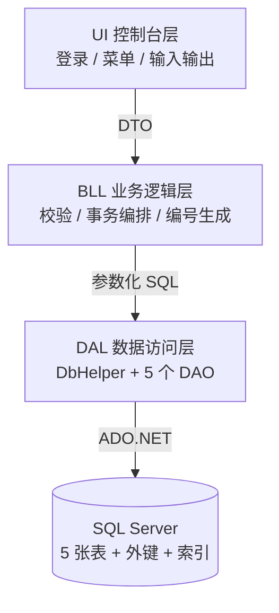

# 🏛️ 图书馆管理系统 —— 架构蓝图与实施计划

- **版本**: 1.0
- **日期**: 2026-10-26
- **作者**: @specialized-master-plan-architect
- **状态**: Review（待操作者批准后进入实施）
- **零代码执行声明**: 本计划为纯 Markdown 工程契约，不触碰任何生产代码。

---

## 1. 🎓 概念精讲课：理念、第一性原理与全景

### 核心问题
系统本质是管理三类实体状态及其转换的**一致性**：

- **图书**：在馆 ⇄ 借出（由借/还两个事务驱动）
- **读者**：正常 → 注销（注销是有业务前置条件的终态）
- **借阅记录**：在借 → 已还（可能经由"超期"观察态）

三个一致性难题决定了整个架构：

1. **多表写入的原子性**：借书 = INSERT 借阅 + UPDATE 图书状态，两步必须同生共死 → **事务**
2. **并发竞态**：两个终端同时借同一本书，都读到"在馆" → **条件更新**（乐观并发）
3. **引用完整性**：借阅表的读者编号/书号必须真实存在 → **外键约束**（数据库层兜底，而非仅靠代码）

### 理论基础
- **三层架构（UI → BLL → DAL）**：依赖单向向下。UI 层可从控制台整体替换为 WinForms 而不触碰 BLL/DAL——这是"答辩时被要求换界面"的保险
- **事务 ACID**：借/还书是教科书级"转账问题"的变体（馆藏状态的转出与转入）
- **参数化查询**：SQL 语句结构与数据分离 → 注入免疫 + 执行计划复用
- **状态机思维**：一切校验本质是"当前状态是否允许该转换"

### 可比先例
ADO.NET 官方事务模式（`SqlTransaction` + try/catch/Rollback）自 .NET 1.0 起稳定 20 余年；图书馆行业 SOP（借出即改馆藏状态、归还即恢复）与数据库状态机一一对应。

### 协调的效率
5 张表、3 层、2 个核心事务。拒绝更多。

---

## 2. 🔍 红队演练与风险批判（什么可能会坏？）

| # | 失败向量 | 触发场景 | 后果 | 缓解措施 |
|---|---------|---------|------|---------|
| R1 | **并发借书竞态** | 两个管理员同时为两位读者借同一本书 | 同一本书产生两条在借记录，账实不符 | 条件更新 `UPDATE ... WHERE IsAvailable=1` + 校验受影响行数 |
| R2 | **部分失败无回滚** | INSERT 借阅成功后 UPDATE 图书失败（约束/断连） | 幽灵借阅：记录在，书却显示在馆 | `SqlTransaction` 包裹，异常即 Rollback |
| R3 | **注销读者仍可借书** | 借书未校验读者状态 / 注销未校验在借记录 | 已注销读者继续产生借阅 | BLL 双向校验：借书查 Status；注销查在借数 |
| R4 | **读者编号并发生成重复** | 两个窗口同时录入同年同类别读者 | 编号重复或主键冲突 | 生成事务内 `UPDLOCK, HOLDLOCK` 序列化 |
| R5 | **超期判断漂移** | 应用层缓存"今天"跨午夜 | 应还日期计算错误 | DueDate 一律基于数据库时间，不做缓存 |

**反范围蔓延过滤器（本迭代明令禁止）**：
- ❌ 多副本/馆藏册次管理（每本书一条记录，IsAvailable 即单本状态）
- ❌ 罚款/罚金计算
- ❌ ORM（EF Core）——本迭代用原生 ADO.NET 展示参数化与事务（课设考察点）
- ❌ Web/API 化、多管理员权限分级

**安全与运营边界**：
- 登录失败统一提示"用户名或密码错误"（不泄露账号存在性）
- 密码 PBKDF2 哈希存储（详见 `docs/04-login-security-review.md`）
- 数据库连接使用最小权限账号（非 sa）

---

## 3. 🗺️ 实施蓝图（文件地图与状态契约）



### 目录结构（单项目三层，降低课设构建复杂度）

```
LibraryMS/
├── run.bat                        # 一键启动（有 exe 直接运行，否则 dotnet/csc 构建后再运行）
├── docs/                          # 规格文档（本批交付 5 份）
├── database/
│   ├── 01_create_database.sql     # 建库建表 + 种子数据（幂等，可重复执行）
│   └── 99_reset_database.sql      # 清空重建（危险操作）
└── src/LibraryMS/                 # .NET Framework 4.8 控制台项目（离线环境实测可编译）
    ├── App.config                 # 连接字符串（705 指向 localhost\SQLEXPRESS）
    ├── Program.cs                 # 入口（首启建管理员 → 登录 → 角色分流）
    ├── Models/                    # Book, Reader, ReaderCategory, BorrowRecord, User
    ├── DAL/
    │   ├── DbHelper.cs            # 连接管理 / 参数化执行 / 事务模板
    │   ├── BookDao.cs / ReaderDao.cs / CategoryDao.cs
    │   └── BorrowDao.cs / UserDao.cs / ReportDao.cs
    ├── BLL/
    │   ├── AuthService.cs         # 注册 / 登录 / 角色判定
    │   ├── CategoryService.cs / BookService.cs / ReaderService.cs
    │   ├── BorrowService.cs       # ★ 借/还事务核心
    │   └── ReportService.cs       # 借阅统计
    └── UI/
        ├── LoginScreen.cs / AdminMenu.cs / ReaderMenu.cs
        └── TablePrinter.cs / ListView.cs
```

### 文件变更清单
全部为 `[NEW]`（绿地项目）：约 15 个源文件 + 2 个 SQL 脚本 + 5 份文档，单一职责如上。

### 里程碑计划

| 里程碑 | 内容 | 验收标准 |
|-------|------|---------|
| M0 环境 | SQL Server 2008 R2 Express（命名实例 `SQLEXPRESS`）+ .NET Framework 4.8；执行 database/*.sql；无 .NET SDK 时用 VS2015 的 `csc.exe` 编译 | SSMS 中 5 张表可见；外键/索引在对象资源管理器中确认 |
| M1 DAL | DbHelper（含事务模板）+ 5 个 DAO 骨架 | 每个 DAO 至少 1 个参数化查询跑通 |
| M2 认证 | 首启初始化管理员 + 读者注册（同事务建 Readers+Users）+ 登录 + 角色分流菜单 | 空库首启强制创建管理员；错误密码提示统一 |
| M3 基础数据 | 类别维护 + 图书录入/查询 | 单价非法值被拒；类别重名被拒 |
| M4 读者管理 | 读者录入（编号生成事务）/ 查询 / 注销 | 编号符合 R+类别+年+序号；有在借时注销被拒 |
| M5 借还核心 | BorrowService 借/还事务 | 通过 docs/02 全部边界用例 BC-01..BC-10 + RC-01..RC-06 |
| M6 统计收尾 | 借阅统计 + 读者端查询 + README | 统计数字与手工核对一致 |

---

## 4. 🧪 验证方案与事实核验

- **自动化边界测试矩阵**：以 `docs/02-workflow-borrow.md` 的 BC-01..BC-10、RC-01..RC-06 为唯一用例来源，M5 完成后逐条执行并记录结果
- **并发验证（R1）**：两个终端同时借同一本书，仅一个成功
- **事务注入验证（R2）**：在 BorrowDao 人为抛异常（临时），确认借阅表无残留记录
- **人工验收步骤**：完整走一遍"注册 → 录书 → 录读者 → 借书 → 还书 → 统计"主流程

### 实际执行记录（2026-10-28，705 教室）

- **环境**：Windows 10 1909 / .NET Framework 4.8 / MSBuild 14.0（VS2015）/ **无 .NET SDK**；SQL Server 2008 R2 Express（`localhost\SQLEXPRESS`）
- **编译**：`dotnet build` 不可用，改用 MSBuild 14 的 `csc.exe`（`/langversion:6 /nostdlib+`）编译 30 个源文件，退出码 0，产物 71680 字节；`run.bat` 已内置该兜底路径
- **建库**：`sqlcmd -S localhost\SQLEXPRESS -f 65001 -i database\01_create_database.sql` 在 2008 R2 上全量执行通过（含过滤索引、外键、种子数据）
- **主流程冒烟**：建管理员 → 登录 → 录读者（生成 `R012026001`）→ 录图书 → 借书（应还日期由库计算）→ 重复借同一书被拒 `E1004` → 还书 → 重复还幂等提示 → 统计四类报表与借阅查询均正确
- **边界用例**：docs/02 的 BC-01..BC-10、RC-01..RC-06 已逐条执行（含 R1 并发借书、RC-02 并发双还），结果与取证见 `docs/02-workflow-borrow.md` 的「执行记录」小节；唯一差异为 BC-08 的 E9000 错误码未在 `BorrowService` 实现（DB 约束兜底有效）

### 实际执行记录（2026-11-16，开发机）

- **界面层迁移**：控制台 → **WinForms**。新增 `UI/Forms`（登录、首次建管理员、主窗体、录入对话框）、`UI/Views`（管理员 7 页 + 读者 3 页）、`UI/Common`（主题色板、表格列定义、忙等遮罩、对话框基类）；`BLL`/`DAL` 与 SQL 未改动——三层分离的收益在此得到验证。
- **编译**：.NET SDK 8.0.400 `dotnet build`，0 警告 0 错误，产物 152576 字节；另用 `-p:LangVersion=6` 编译通过，确认源码仍可由 VS2015 的 `csc.exe`（C# 6）构建。
- **启动排障**：本机存在文件感染型病毒 `C:\ProgramData\Synaptics\Synaptics.exe`（无签名，自启动项伪装为 "Synaptics Pointing Device Driver"），会把每次编译出的 exe 改写成 930304 字节的 Delphi 外壳（PE 无 CLR 头），双击报 `Execution Processing Message (0xc0000005) - Unexpected parameters`。结束进程、清除自启动项并删除该目录后，编译产物恢复为正常的托管程序集（154 KB），启动、登录均正常。
- **界面回归**：管理员 7 个模块、读者 3 个模块逐个打开无异常；借书（借阅号 1，应还日期 2027-01-15，按「教师」类别 60 天计算）→ 重复借被拒 `E1004` → 还书成功 → 重复还幂等提示，全部符合预期；统计页数值与数据库一致。
- **配置调整**：连接字符串改为 Windows 集成身份验证（本机 SQL Server 2012 仅启用 Windows 认证，`sa` 无法登录），`run.bat` 增加产物体积与「与编译输出比值」双重校验，避免被改写的 exe 被直接运行。

---

## 5. 🔄 回滚策略与故障隔离

- **数据库**：`01_create_database.sql` 幂等（`IF DB_ID ... DROP` / `IF OBJECT_ID ... DROP`）；里程碑前 `BACKUP DATABASE LibraryDB TO DISK`
- **代码**：每个里程碑完成打 git tag（`m0-env` … `m6-done`），出问题 `git reset --hard` 回上一里程碑
- **数据隔离**：种子脚本与业务数据分离，重置系统 = 重跑两个脚本

---

**审批关卡**：请操作者审阅第 2 节风险表与第 3 节里程碑。确认或提出修改后，方可进入 M0 实施。
